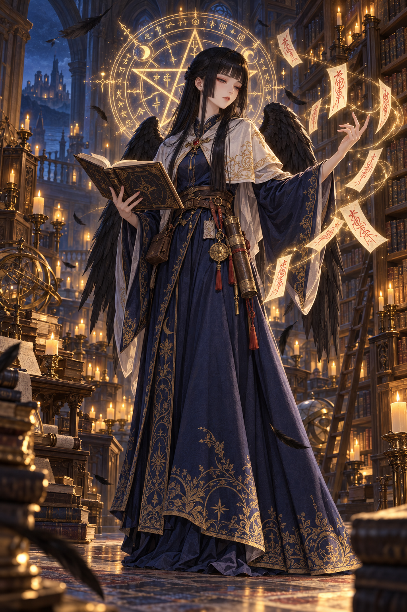

# 希娜·露弥（Hina Lumi）立绘

D&D 5e 角色希娜·露弥的立绘及其绘制过程：用了哪些工具、提示词怎么写、怎么迭代到定稿。

> 希娜是两位大妖怪的女儿，生于日式文化的半位面。幼时父母遭仇人袭击，母亲带她逃到费伦，托付给烛堡的旧识抚养；她体弱少出门，却天赋惊人，17 岁便能把阴阳道与费伦魔法融合，创出新法术，如今是 14 级的书士会法师。



## 使用的工具

| 用途 | 模型 / 工具 |
|---|---|
| 讨论画面、SVG 氛围草图、撰写生图提示词 | Claude Opus 5.5（claude.ai） |
| 生成正式立绘 | ChatGPT（GPT 图片生成） |

## 绘制过程

1. **氛围草图**：把角色设定交给 Claude，先用 SVG 画一张草图，确认它对画面的理解。
2. **修正外观**：草图偏巫女风。改为公主切发型、费伦式法师服装，日式元素只保留在黑色鸦羽和红字符纸上。
3. **写提示词**：让 Claude 根据确认后的画面写英文生图提示词（见下）。
4. **生成立绘**：交给 ChatGPT 生成，共出了两张，**最终采用第一张**。

## 画面要点

- **人物**：人形，黑色鸦羽长在背后（不是鸟头、没有鸟喙、不是 kenku）；公主切黑色长直发；苍白纤细。
- **服装**：费伦式，深靛蓝及地长袍配金色刺绣，米白短斗篷，红宝石扣，皮带挂卷轴筒。
- **动作**：一手捧法术书，一手召出写着红色毛笔字的符纸。
- **背景**：夜晚的烛堡书库；身后是融合阴阳道五芒星与西式奥术符文的法阵。
- **配色**：靛蓝、米白、绯红，加烛光的金色；冷色阴影对比暖色烛光。

## 提示词

```
Fantasy character portrait of Hina Lumi, a young female wizard of the Order of Scribes in the Forgotten Realms, with Japanese tengu heritage. Human-like appearance with large black crow wings folded behind her back (no beak, no bird head, not a kenku). Pale, delicate, slightly frail look, calm half-lidded eyes, faint red accent at the outer corners of the eyes. Long straight black hair in a hime cut: blunt straight bangs, cheek-length side locks, the rest falling to her waist. She wears Faerûnian scholar-wizard clothing, not Japanese clothing: a deep indigo floor-length robe with gold-embroidered hem, bell sleeves, an ivory short mantle fastened with a red gem clasp, a leather belt with a scroll case and small pouches. She holds an open spellbook in one hand; with the other she casts a spell, summoning floating paper ofuda talismans with red brush calligraphy. Behind her, a glowing magic circle that fuses an onmyodo five-pointed star (Seimei pentagram) with Western arcane runes. Setting: the candlelit library of Candlekeep at night, towering bookshelves, warm candlelight against cool blue shadows, drifting black feathers and golden motes of light. Quiet, elegant, scholarly, slightly melancholic mood. Detailed fantasy illustration, D&D character art, painterly style, soft rim lighting, full-body, vertical composition. Avoid: beak, bird head, kimono, armor, text.
```

用 Midjourney 时，把末尾的 `Avoid: …` 换成：

```
--no beak, bird head, kenku, feathered face, kimono, hakama, shrine maiden outfit, armor, modern clothing, extra limbs, extra wings, deformed hands, text, watermark --ar 2:3 --style raw --s 250
```

## 结果与经验

- **第一张（定稿）**：发型、服装、符纸、书库都对上了，整体是"强大从容"的 14 级法师形象。不足：袖子偏宽有和服感、病弱感不明显、翅膀结构不太清楚、法阵更像西式五芒星。
- **第二张（未采用）**：在同一会话里追加修改，袖子改窄成功了，但模型没有替换斗篷，而是又叠了一层流苏披肩，布料缠在一起。
- **经验**：小改动（表情、配色）可以在原会话里接着改；结构性改动（加减衣物、改姿势）最好开新会话重写完整提示词。改衣物时用 "replace…" 而不是 "add…"，避免叠层。若模型把 tengu 画成鸟头人，可以删掉 tengu，只保留 "black crow wings"。
