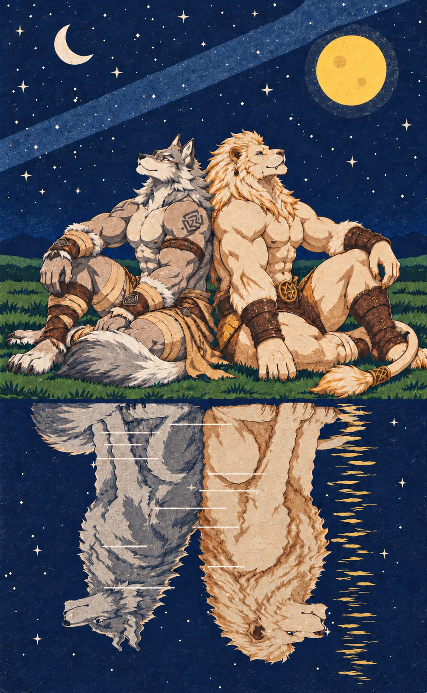
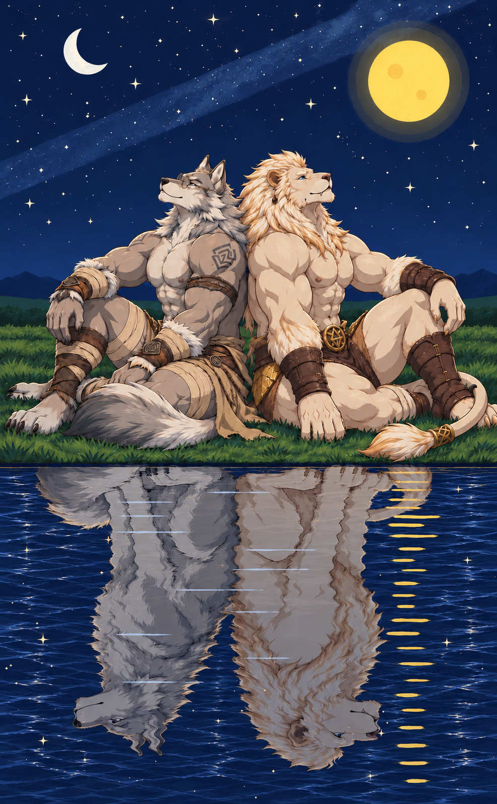

# 狼与白狮 · 星空背靠背

一张星空插画：灰白狼兽人和白狮兽人背靠背坐在湖岸上抬头看星星，湖面里的倒影是一只真正的狼和一只白狮。下面记录这张图是怎么做出来的：构图、提示词、拆图拼合和最后的版画化。

> 两人在夜里的湖边并肩看着两轮月亮；水面映出的，是他们本来的样子。



## 使用的工具

| 用途 | 模型 / 工具 |
|---|---|
| 讨论画面、SVG 构图示意、撰写生图提示词、拼合两张图 | Claude Opus 5.5（claude.ai） |
| 生成角色画面、动物倒影，以及最后的版画风格转绘 | ChatGPT（GPT 图片生成） |

## 文件

| 文件 | 内容 |
|---|---|
| `wolf_lion_stars.png` | 定稿：版画风格（986×1596） |
| `wolf_lion_stars_alt.png` | 另一版：同一张拼合图，用更宽泛的提示词统一上下画风、增加水面细节 |
| `composition.svg` | Claude 画的构图示意（第 2 版，细化了尾巴和湖面） |



## 制作过程

1. **先定构图**：用 SVG 画上中下三段的示意图（夜空和两轮月亮 / 背靠背坐在湖岸 / 湖面倒影），确认后才写提示词。根据设计者的反馈改了三处：人物要紧贴水面，倒影才符合物理；草地要连到画面两边，不能是小岛；尾巴每人只能有一条，从各自的尾椎伸出。
2. **单图尝试**：一次生成整张图。风格从厚涂改成平涂分色，服装按参考图原样保留，没有另加衣服。问题始终出在水面：只要画面里有水，模型就会把岸上的兽人镜像下去再换个动物头，倒影里还是兽人的屈膝坐姿。
3. **拆成两张图**：图 A 明确写不要出现水，只画到岸边卵石为止；图 B 让模型把四足动物**正着**画在纯色背景上，因为模型画倒立的动物容易画歪。
4. **拼合**（Claude 用脚本完成，脚本没有保留）：
   - 从岸边裁开图 A，并去掉人物脚下多余的草地。
   - 图 B 抠掉背景后垂直翻转，狼和狮子分别量出爪底，让爪底正好贴在水岸线上，越过水岸线的那截尾巴裁掉。
   - 比例按头顶到水岸线的距离来定，让倒影和岸上人物一样大。画布也因此加高到 1254×2030，不再是 2:3。
   - 倒影压暗、略微偏蓝，越往下越淡，再加一点逐行的左右错位当水波。圆月正下方画一列金色月光条，放在倒影下面，会被尾巴挡住；湖里另外撒了些星点。
5. **转绘**：把拼合图交给 ChatGPT 统一画风，得到两版。定稿是版画风格，同一个对话里改了三次；另一版用的提示词更宽泛（提示词都在下面）。GPT 改图其实是整张重画，所以细节会有些漂移。

## 提示词

### 角色片段

下面的整图提示词里，`[WOLF fragment]` 和 `[WHITE LION fragment]` 替换成这两段：

```
WOLF (left): the anthropomorphic grey-white wolf from image 1, same build, face and outfit: fluffy neck ruff, long muzzle, thin gold-rimmed round glasses, amber eyes, a faint gentle smile; geometric tattoo on the upper arm, leather armband; a tattered sand-coloured linen waist wrap tied with a brown leather belt, a round bronze buckle and a hanging rune-carved strap; cloth wrist wraps with fur cuffs, beige leg wraps, bare wolf feet; long bushy grey-white tail.

WHITE LION (right): the anthropomorphic white lion from image 2, same build, face and outfit: cream-white fur, long flowing pale-gold mane, pinkish-brown nose, grey-blue eyes, small dark stud earring in the left ear, calm closed-mouth smile; dark brown leather loincloth with a wide belt and a round gold buckle engraved with a triangular rune, gold-brown plates at the hips; wide riveted dark-brown leather bracers; tall strapped dark-brown leather boots; lion tail with a pale-gold tuft and a small gold ring.
```

### 图 A（上传两张角色参考图和构图示意）

```
Create a square 1:1 FLAT 2D illustration: cel-shaded, hard-edged flat colour fills, clean crisp outlines, 2-3 flat tones per area, limited palette, no brush strokes, no gradients, no blended colour patches. Image 1 is the wolf reference, image 2 is the white lion reference; keep their build, faces, fur, outfits and accessories exactly. Image 3 is a composition sketch: use ONLY its upper part, above the dashed waterline.

The image shows a starry deep-blue night sky with a simple flat milky way, a small cold-white crescent moon upper left and a large bright yellow full moon upper right with a flat halo ring. Below, a wide continuous grassy shore stretches to both side edges and back to low distant hills. The two anthro characters sit back to back at the exact horizontal centre, spines touching, heads tilted up to the stars, calm soft smiles; their seats are near the bottom edge.
- LEFT, facing left: [WOLF fragment]
- RIGHT, facing right: [WHITE LION fragment]
TAILS: each has exactly ONE tail from the base of his own spine: the wolf's bushy tail drapes forward-left over the grass, the lion's thin tail curves forward-right ending in a pale-gold tuft with a gold ring. No extra tails.

The bottom edge of the image is the shore edge itself: a narrow strip of grass and small pebbles running straight across the full width. NO water, NO lake, NO reflection anywhere in the image. No text.
```

### 图 B（在图 A 的同一个对话里接着发）

```
In exactly the same flat 2D cel-shaded style and palette as the previous image, create a landscape 3:2 image of two real four-legged animals (not anthro, no clothes, no accessories): a grey-white wolf on the LEFT facing left, and a white lion with a pale-gold mane on the RIGHT facing right. They sit upright on their haunches back to back, rumps touching at the exact horizontal centre, heads raised to look up at the sky, calm. Each has exactly one tail, curled forward around its own front paws. All paws rest on one straight horizontal ground line near the bottom edge. Light them with a soft gold rim light from the upper right. Plain solid flat light-grey background, no ground texture, no sky, no water, no shadow, no text. The two animals together should fill about 60% of the image width.
```

### 定稿：版画化（上传拼合图，同一对话里改了三次）

第 1 次：

```
Edit the attached image. Style transfer only: re-render it as a printmaking piece (woodcut / linocut / screen print look) with NO brush strokes — flat ink layers, crisp carved edges, a limited set of colour separations, slight ink grain and paper texture.
Keep the composition EXACTLY identical to the input: same 2:3 canvas, same position, size, pose, silhouette and outline of every element; same faces and expressions, glasses, earring, tattoo, bracers, belts, buckles, wraps and tails; same moons, stars, milky way band, horizon, waterline, animal reflection, ripples and moonlight stripes; same colour palette and lighting. Do not add, remove, move, crop, extend or redraw anything, and do not change anatomy or proportions. Only the rendering surface changes.
```

第 2 次（在图上点选了金色月光条的位置 x: 81%, y: 79%）：

```
修改水波的质感！只修改这一处，其余所有地方都保留原样
```

第 3 次：

```
让其更具有水波的真实感。仅修改金色波纹这一处
```

### 另一版（上传拼合图）

```
1 重绘这张画，不改变画面元素，使得上下画风统一
2 水面的细节不够，增加水面的细节
不要更改倒影的任何内容
```

## 经验

- **先确认构图再写提示词**：构图错了，提示词写得再好也没用。草图阶段改起来最便宜。
- **倒影和本体不一样时就拆图**：扩散模型生成倒影的倾向很强，画面里只要有水就会去镜像岸上的东西。把水面以上和倒影分成两张生成，再自己翻转拼合，比在单图里反复修改更可控。
- **动物正着画再翻转**：模型画倒立的动物经常画歪，正着画再翻转更准。
- **不要擅自改角色设定**：外形和服装都照参考图原样，不要替设计者"修饰"。
- **局部修改要明确圈定范围**：最后两轮只点了月光条一处，并写明"其余保留原样"，其他地方基本没动。
