# 素材库

可复用的 `bpy` 素材：每个素材是一个 `.py`（生成代码，带参数）加一张同名 `.png`（缩略图）。场景脚本直接 `import` 素材，不用复制粘贴；改素材只改这一份代码，所有用到它的场景重新生成时都会跟着变。

| 素材 | 缩略图 | 内容 | 参数 | homebase 里 |
| --- | --- | --- | --- | --- |
| [`alembic`](alembic.py) | 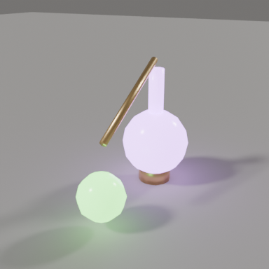 | 蒸馏器：烧瓶、铜管、接收瓶、炉子 | `flask` `receiver` | 书桌上 |
| [`arched_door`](arched_door.py) | 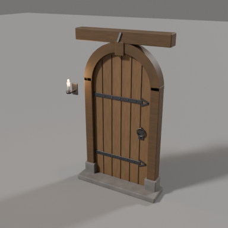 | 圆头橡木板门：木门框、带状合页、门环、锁板、石门槛，可带壁挂烛台 | `width` `height` `frame` `sigil` `sconce` | （黑杖塔办事处） |
| [`banner`](banner.py) | 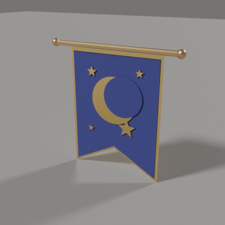 | 燕尾旗：金边、新月和星星、铜杆 | `width` `length` `notch` `cloth` `emblem` | 左墙 |
| [`bookshelf`](bookshelf.py) | 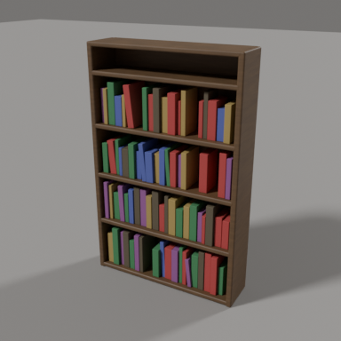 | 书架，随机摆满书 | `width` `height` `depth` `books` `rng` | 后墙 |
| [`candle`](candle.py) | 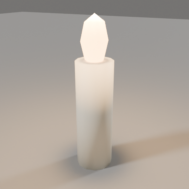 | 蜡烛，可带点光源 | `height` `radius` `light` | 桌上、壁炉台、漂浮蜡烛 |
| [`cauldron`](cauldron.py) | 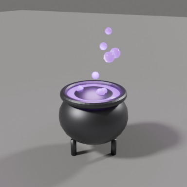 | 三足坩埚，发光药水和气泡 | `brew` `bubbles` `light` `rng` | 右后角 |
| [`chair`](chair.py) | 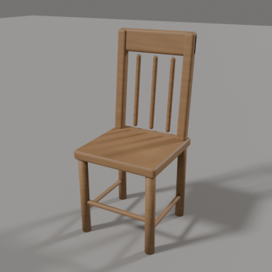 | 木椅，可加坐垫 | `seat_height` `width` `back_height` `back_tilt` `spindles` `leg_radius` `wood` `cushion` | 圆桌边五把 |
| [`chest`](chest.py) | 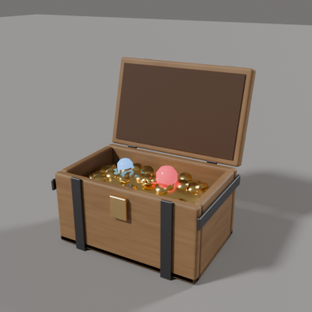 | 宝箱：铁箍、可开合的盖、金币堆 | `lid_angle` `gold` `coins` `rng` | 右前方 |
| [`crystal_ball`](crystal_ball.py) | 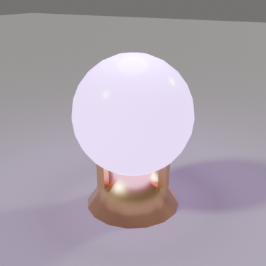 | 水晶球和铜爪底座 | `radius` `glass` `light` `light_color` | 圆桌上 |
| [`curved_bookshelf`](curved_bookshelf.py) | 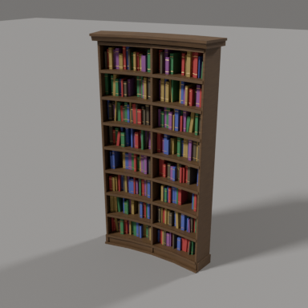 | 贴合圆墙的弧形书架：底座、檐线、隔板、层板挡边，书脊带金线 | `radius` `arc` `height` `depth` `shelf_gap` `sections` `wood` `books` `rng` | （黑杖塔办事处） |
| [`desk`](desk.py) | 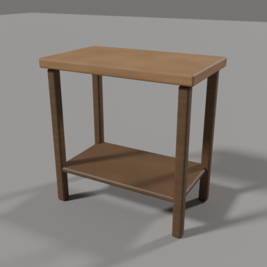 | 带下层隔板的小书桌 | `width` `depth` `height` | 炼金台 |
| [`fireplace`](fireplace.py) | 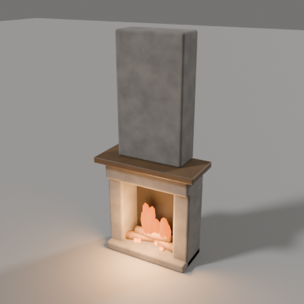 | 石砌壁炉：烟囱、壁炉台、木柴、火焰、余烬 | `fire` `rng` | 左墙 |
| [`great_fireplace`](great_fireplace.py) | 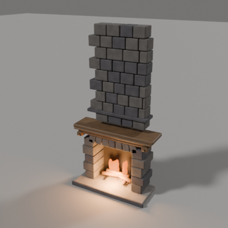 | 大石壁炉：烟熏石与玄武岩、平拱拱心石、线脚壁炉台和托架、烟囱墙腰线 | `chimney_top` `fire` `rng` | （黑杖塔办事处） |
| [`high_back_chair`](high_back_chair.py) | 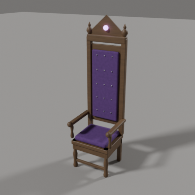 | 雕花高背椅：车削腿和顶饰、拉扣靠垫、卷头扶手、尖顶板和宝石 | `back_height` `wood` `cushion` `gem` `tufts` | （黑杖塔办事处） |
| [`hourglass`](hourglass.py) | 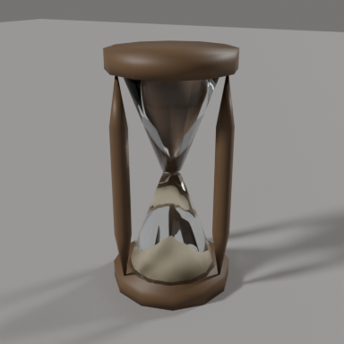 | 沙漏 | `height` `wood` | （黑杖塔办事处） |
| [`inkwell`](inkwell.py) | 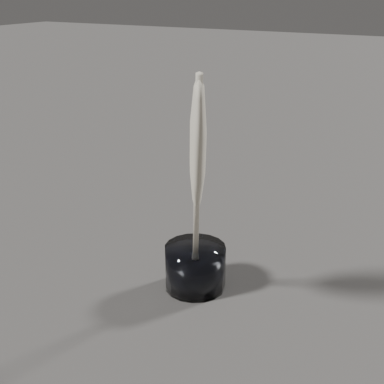 | 玻璃墨水瓶和羽毛笔 | `radius` `quill` | （黑杖塔办事处） |
| [`lancet_window`](lancet_window.py) | 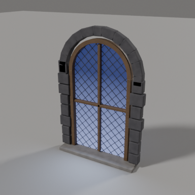 | 圆头窗：菱格铅条、木窗框、玄武岩窗套、石窗台、星空，可带月光和光束 | `width` `height` `sill` `light` `rng` | （黑杖塔办事处） |
| [`map_table`](map_table.py) | 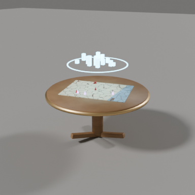 | 三脚圆桌，钉着城市地图，上方浮着发光的城市幻影 | `radius` `height` `wood` `illusion` `glow` `rng` | （黑杖塔办事处） |
| [`miniature`](miniature.py) | 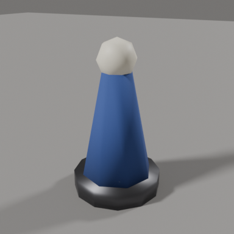 | 桌游棋子 | `color` | 地图上四个 |
| [`mortar`](mortar.py) | 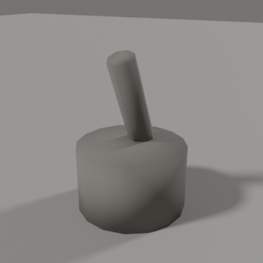 | 石研钵和杵 | `radius` | 书桌上 |
| [`open_book`](open_book.py) | 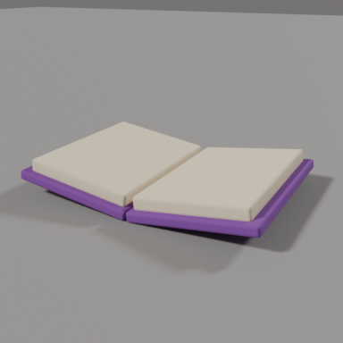 | 摊开的书 | `width` `depth` `thickness` `angle` `cover` | 魔法书、三本飞书 |
| [`portrait`](portrait.py) | 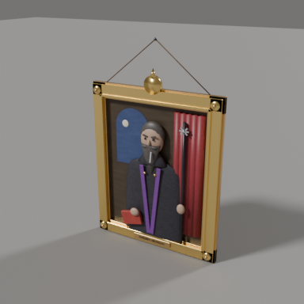 | 油画肖像：阶梯金框、角花和顶饰，画面浅浮雕（拱窗夜空、红帷幕、持黑杖的法师半身像），铜铭牌、挂绳 | `width` `height` `border` `robe` `beard` `plate` `cord` | （黑杖塔办事处） |
| [`potion`](potion.py) | 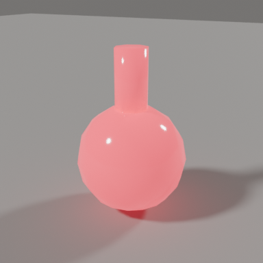 | 圆底药水瓶 | `radius` `liquid` | 窗台 |
| [`round_table`](round_table.py) | 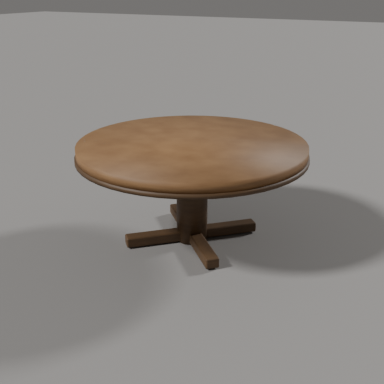 | 独脚圆桌 | `radius` `height` | 房间中央 |
| [`rug`](rug.py) | 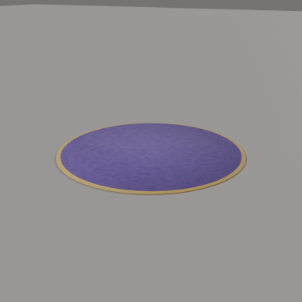 | 圆地毯，金色包边 | `radius` `color` `border` | 圆桌下 |
| [`scroll_cabinet`](scroll_cabinet.py) | 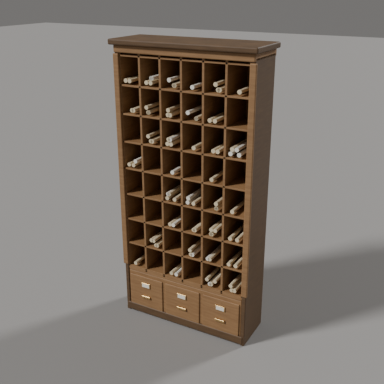 | 卷宗格子柜：卷轴和火漆封、三屉底座带铜标签框、雕花立条、檐线 | `width` `height` `depth` `cols` `rows` `wood` `trim` `rng` | （黑杖塔办事处） |
| [`shield`](shield.py) | 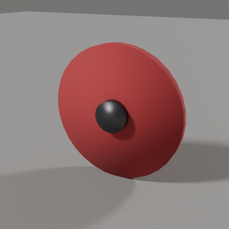 | 圆盾，可加金属包边 | `radius` `color` `boss` `rim` | 壁炉上方、武器架旁 |
| [`spiral_stair`](spiral_stair.py) | 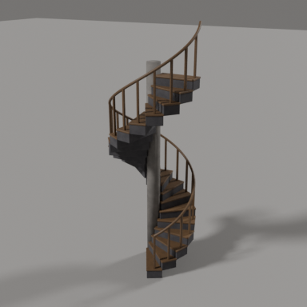 | 螺旋楼梯：玄武岩踏步、木踏板、石中柱、木栏杆和螺旋扶手 | `height` `steps` `turn` `radius` `start` | （黑杖塔办事处） |
| [`staff`](staff.py) | 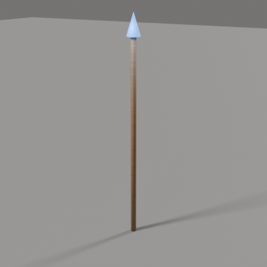 | 法杖，顶端水晶或带环法球 | `length` `radius` `head` `wood` `glow` `light` | 武器架 |
| [`summoning_circle`](summoning_circle.py) | 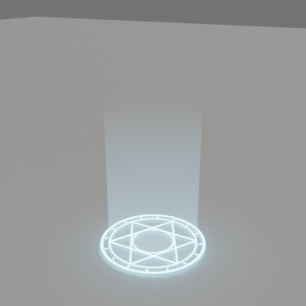 | 召唤法阵：三圈光环、六芒星、符文、光柱 | `glow` `beam` | 地板 |
| [`sword`](sword.py) | 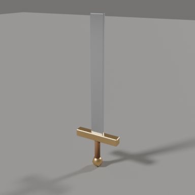 | 长剑 | `length` | 武器架 |
| [`tankard`](tankard.py) | 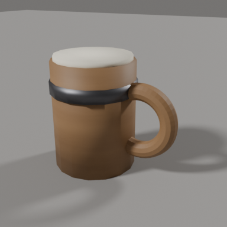 | 木酒杯，铁箍、泡沫、把手 | `radius` `height` `foam` | 圆桌上 |
| [`vial_rack`](vial_rack.py) | 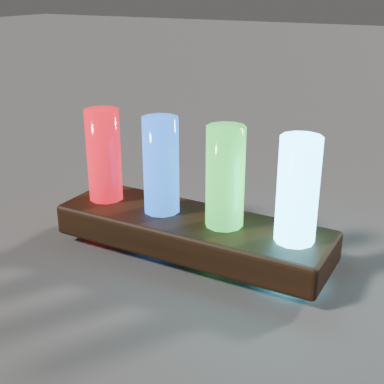 | 试管架和一排发光试管 | `colors` | 书桌上 |
| [`weapon_rack`](weapon_rack.py) | 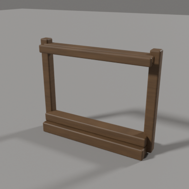 | 武器架（不含武器） | `width` | 后墙 |
| [`wheel_chandelier`](wheel_chandelier.py) | 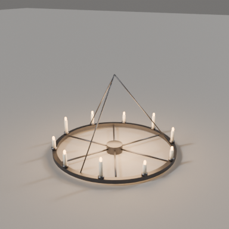 | 铁环蜡烛吊灯：轮辐、烛杯、三根吊链（原点在挂钩） | `radius` `candles` `drop` `light` | （黑杖塔办事处） |
| [`window`](window.py) | 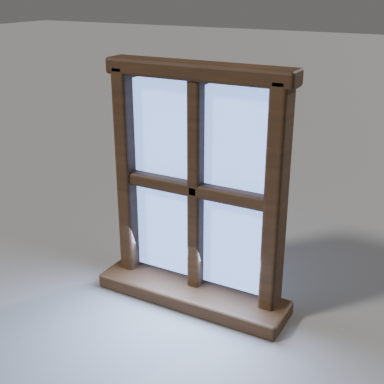 | 窗户：发光玻璃、十字框、窗台、月光 | `width` `height` `light` | 后墙 |
| [`wizard_hat`](wizard_hat.py) | 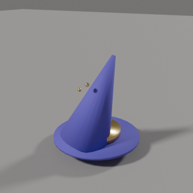 | 法师帽 | `color` `height` `brim` | 圆桌上 |
| [`writing_desk`](writing_desk.py) | 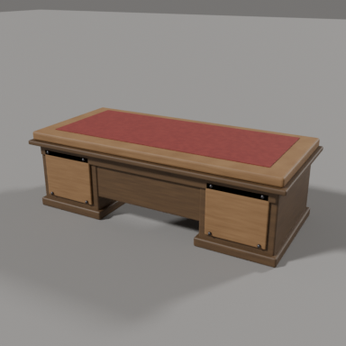 | 双柜大书桌：皮面桌面、抽屉朝坐的一侧、访客一侧是带铁钉的雕花板 | `width` `depth` `height` `top` `body` `leather` | （黑杖塔办事处） |

| 文件 | 说明 |
| --- | --- |
| `lib.py` | 公共工具：`box` `cyl` `sphere` `cone` `torus` 等基本体，`group` 把零件挂到根对象，共用材质表 `palette()` / `material("wood")`，`reset` 清空场景；生成网格的 `shell`（圆环/扇形管）、`lathe`（车削件）、`arch_slab`（圆头板）、`Batch`（大量小块合并成一个网格）、`mesh_obj`；动画用的 `keyframe` / `wave` |
| `thumbnail.py` | 给素材渲染缩略图（中性灰背景、四分之三视角，按素材大小自动取景） |

## 素材的约定

每个素材文件提供一个函数：

```python
build(name, loc=(0, 0, 0), rot_z=0.0, *, 素材自己的参数...) -> 根对象
```

- 原点在素材底部中心（落在地面上），正面朝 -y。
- 所有零件挂在一个空物体（根对象）下面，移动、旋转根对象就行。
- 材质统一来自 `lib.palette()`（木头、铁、金、各色布料、发光药水等），按名字缓存，同一个场景里所有素材共用。颜色类参数可以传材质、材质表的键（如 `"purple"`）或 `(r, g, b)`。
- 参数都有默认值；默认值就是缩略图里的样子，也就是 homebase 里的样子。
- 带随机的素材（书架、宝箱、坩埚、壁炉）有 `rng` 参数，默认固定种子，每次生成都一样；场景可以传自己的随机源。
- 挂墙的素材（窗、壁炉、旗帜）原点在墙面上，正面朝 -y；挂到左墙（朝 +x）时 `rot_z=math.pi / 2`。
- 剑、法杖这类要斜放的，`build()` 返回根对象后再设 `rotation_euler`。

## 在场景里使用

```python
import os, sys
sys.path.insert(0, os.path.dirname(os.path.dirname(os.path.abspath(__file__))))  # 指向 scenes/

from assets import cauldron, chair, round_table

round_table.build("Table", loc=(2.0, 2.0, 0))
chair.build("Chair0", loc=(1.0, 2.0, 0), rot_z=-1.57, cushion="purple")
chair.build("BarStool", loc=(3.0, 2.0, 0), rot_z=1.57, seat_height=0.7, back_height=0.9, spindles=5)
cauldron.build("Pot", loc=(3.5, 3.5, 0), brew=(0.2, 0.9, 0.3))   # green brew
```

## 生成缩略图

```bash
# 一个素材，输出到 scenes/assets/chair.png
scenes/blender.sh scenes/assets/thumbnail.py chair

# 全部素材
scenes/blender.sh scenes/assets/thumbnail.py all

# 预览改过参数的版本（不覆盖正式缩略图）
scenes/blender.sh scenes/assets/thumbnail.py chair --set seat_height=0.7 --set spindles=5 --out out/tall.png
```

参数：`--out 路径`、`--samples N`（默认 64）、`--size 像素`（默认 384，正方形）、`--set 参数=值`（可重复，值按 Python 字面量解析，如 `--set "cushion=(0.2,0.05,0.35)"`）。默认设置一张约 5 秒，全部约 2 分钟。在 VM 的 Mac 沙箱里照常加 `BLENDER=/Applications/Blender_beta.app/Contents/MacOS/Blender` 前缀。

## 新增一个素材

1. 在这里新建 `<名字>.py`，写 `build()`，从 `assets.lib` 引用基本体和材质。
2. 运行 `thumbnail.py <名字>` 生成 `<名字>.png`，看一眼对不对。
3. 在上面的素材表里加一行。

从现有场景里拆素材时，先保证默认参数生成的几何和原来一致，再把场景里的那段代码换成 `import`。核对方法：拆之前后各存一份 `.blend`（不加动画），逐个网格比对世界坐标顶点和材质。homebase 拆完后 673 个网格里 644 个完全一致；剩下的是有意的小调整：魔法书和三本飞书改用同一个 `open_book`（魔法书两半改为绕书脊一起转，飞书页面差几毫米），法杖的头改为长在杖顶（原来离杖顶差十几厘米），斜靠的盾的盾钉略短，试管架居中，旗杆端球和盾边转了一个角度（看不出来）。
