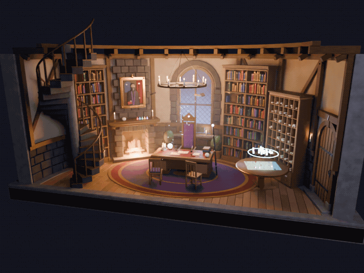

# 黑杖塔办事处

深水城黑杖塔里「黑杖」的办事处内景，用 `bpy` 程序化搭建的剖面场景，风格与 [`homebase`](../homebase/) 统一：石、木、灰泥用同一套材质，同样是木骨灰泥墙、木地板和外露的椽子。房间是塔内圆厅靠里的半圆形办公区，直径约 10 米，前面沿直径切开，方便看清内部。



场景内容：

- 墙下半截是一块块垒起的黑色玄武岩，对应黑杖塔的黑石；上半截是木骨灰泥墙，有斜撑和椽子。地面是带木钉的橡木窄板，外圈压着石砌边沿。
- 正中是一张厚重的橡木书桌，两侧是抽屉柜。桌上有账册、文件、墨水瓶和羽毛笔、火漆印章、沙漏、烛台、水晶球和头骨。高背座椅雕花：车削的腿和顶饰，靠垫上有拉扣，椅背顶上嵌着紫色宝石。黑杖靠在桌边。
- 桌前两把访客椅和一块圆地毯。
- 座椅后面是一扇圆头窗，玄武岩窗套，菱格铅条玻璃，透进月光。塔从外面看没有窗，这扇是魔法窗。
- 窗右侧和左端各有一组弧形书架。
- 窗左侧是石砌壁炉，烟囱墙上挂着第一代黑杖凯尔本的油画肖像：阶梯金框带角花和顶饰，画面是浅浮雕的半身像（黑袍、黑胡子、手持顶端银星的黑杖），背景是拱窗夜空和红帷幕，下面有铜铭牌。
- 右侧是房间的门：圆头橡木板门，带状合页、门环、锁板，门边一盏壁挂烛台。门旁边是卷宗格子柜，前面是摆着深水城地图的圆桌，上方浮着城市幻影。
- 左端是通往上层的石砌螺旋楼梯；头顶是一盏铁环蜡烛吊灯；屋里有薄雾和月光里的浮尘。

动画是 2 秒循环：炉火和烛火跳动，灯光轻微明暗，水晶球和地图上的幻影呼吸般发光，幻影来回轻转，飞书和浮尘缓缓漂动。

| 文件 | 说明 |
| --- | --- |
| `build_scene.py` | 生成整个场景的脚本：房间外壳（墙、地板、梁）在这里，家具和道具都从 [`scenes/assets/`](../assets/) 引用 |
| `blackstaff_office_loop.gif` | 6 秒循环 GIF（48 帧，8 fps，720×540） |

## 用到的素材

全部来自 [`scenes/assets/`](../assets/)：门 `arched_door`、窗 `lancet_window`、壁炉 `great_fireplace`、肖像 `portrait`、书架 `curved_bookshelf`、卷宗柜 `scroll_cabinet`、书桌 `writing_desk`、高背椅 `high_back_chair`、访客椅 `chair`、地图桌 `map_table`、螺旋楼梯 `spiral_stair`、吊灯 `wheel_chandelier`，以及桌上和台上的 `candle`、`crystal_ball`、`potion`、`inkwell`、`hourglass`。生成弧形墙体、车削件、批量网格的工具也在 `assets/lib.py` 里。

## 如何运行

本地配置 Blender 的方法见 [`scenes/ENVIRONMENT_SETUP.md`](../ENVIRONMENT_SETUP.md)。

```bash
scenes/blender.sh scenes/blackstaff-office/build_scene.py --render out/wide.png --shot wide
```

常用参数：

- `--shot wide|close|top`：全景 / 办公桌特写 / 正交俯视
- `--samples N`：渲染采样数（默认 128）
- `--res 百分比`：渲染分辨率百分比（全分辨率 1600×1200）
- `--anim 帧目录 [--step N]`：渲染动画帧（48 帧，24 fps）
- `--save out.blend`：保存为 `.blend` 文件

生成循环 GIF（和 homebase 一样：2 秒的 48 帧按 8 fps 播放，720×540）：

```bash
scenes/blender.sh scenes/blackstaff-office/build_scene.py --anim out/office_frames --samples 48 --res 45
scenes/blender.sh scenes/tools/frames_to_gif.py out/office_frames scenes/blackstaff-office/blackstaff_office_loop.gif --fps 8
```

`frames_to_gif.py` 只用 Blender 自带的 numpy 和图片读取，不需要 ffmpeg 或 PIL。
