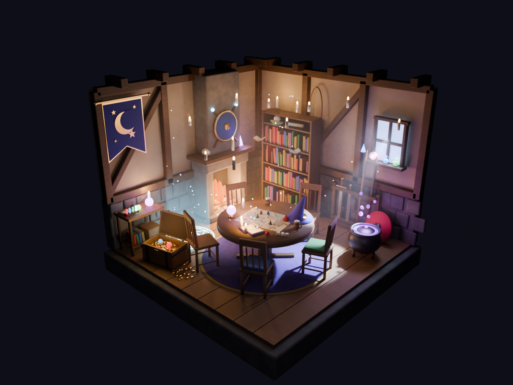

# 法师小队据点

一个用 `bpy` 程序化搭建的剖面小房间，作为冒险队伍的据点。场景里有木骨灰泥墙、壁炉、摊着地图的圆桌和五把椅子、书架、法杖与长剑的武器架、炼金台、宝箱、紫色坩埚、带光柱的召唤法阵、漂浮的蜡烛和书本、弥漫的薄雾与一束月光，还有一面新月旗帜。



| 文件 | 说明 |
| --- | --- |
| `build_scene.py` | 生成整个场景的脚本：房间、墙和散放的小东西在这里，家具和道具都从 [`scenes/assets/`](../assets/) 引用 |
| `homebase_render.png` | 全景渲染 |
| `homebase_closeup.png` | 圆桌特写 |
| `homebase_top.png` | 正交俯视图 |
| `homebase_anim.mp4` | 2 秒定格动画循环（8 fps） |
| `homebase_loop.gif` | 6 秒循环 GIF |

## 如何运行

```bash
# 用 Blender 无界面模式（推荐）
scenes/blender.sh scenes/homebase/build_scene.py --render out/wide.png --shot wide

# 或用 Python + bpy（pip install bpy）
python3 scenes/homebase/build_scene.py --render out/wide.png --shot wide
```

常用参数：

- `--shot wide|close|top`：选择镜头（全景 / 特写 / 俯视）
- `--samples N`：渲染采样数
- `--res 百分比`：渲染分辨率百分比
- `--anim 帧目录 [--step N]`：渲染动画帧
- `--save out.blend`：保存为 `.blend` 文件

`.blend` 文件可以随时由脚本重新生成，所以没有提交进仓库（见 `.gitignore`）。
