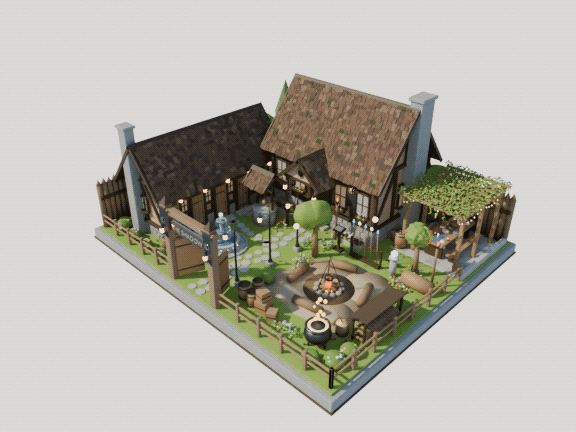
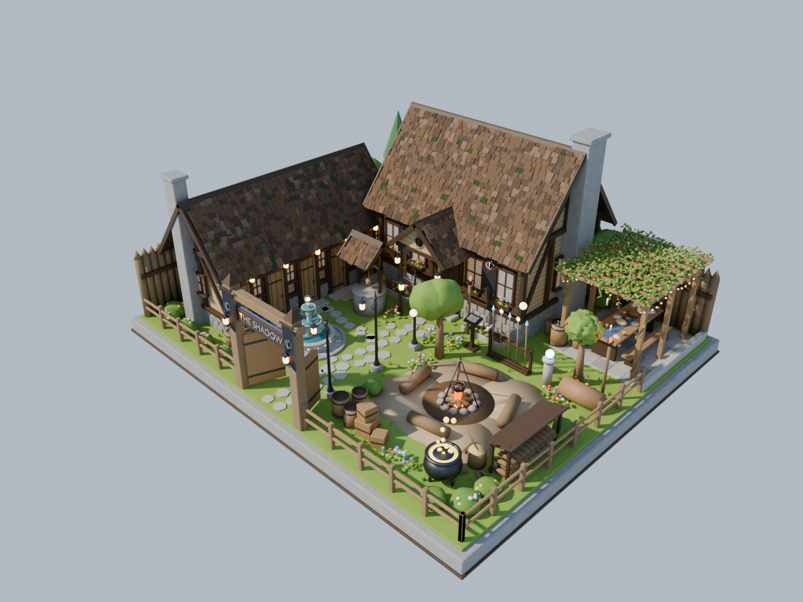
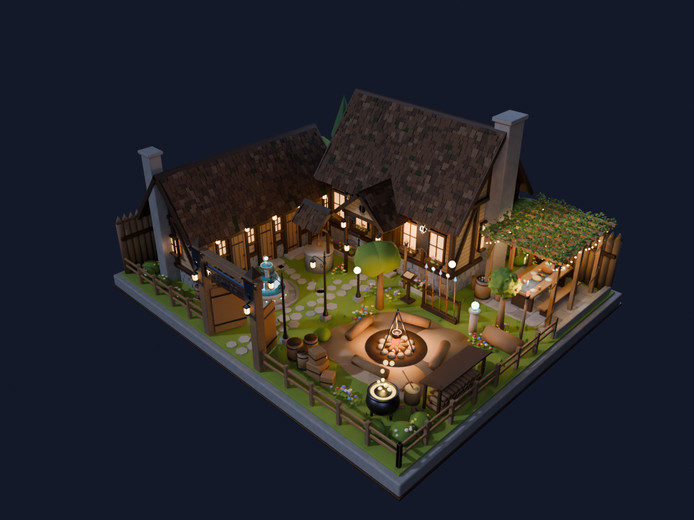

# the Shadow 据点（外景）

冒险小队「the Shadow」在深水城的据点，用 `bpy` 程序化搭建的外景沙盘。整体是欧洲西幻的旧木屋：石砌墙基、深色木骨架、浅色横木板墙、深褐色的旧木瓦屋顶。尺寸按米计，底座 14 × 12 米，默认是白天，也可以切成夜景。小队全员都是施法者，院子里散落着他们的魔法用品。



- **大厅**（后方正中）：石墙基、木骨架、横木板墙，屋顶是参差的木瓦，夹着几块青苔，屋脊压两块人字木板。门前是朝前的人字山墙门廊，山墙上挂队徽，门两侧挂着队旗。右侧山墙是石烟囱，左侧堆着柴火，正面窗下有花箱，门前左右各一个花圃。
- **宿舍**（左侧，门朝院子）：五个人一人一间，每间一扇原木门、一扇窗、一块彩色门牌（银点表示房号）、一张麻布门垫和一盏小提灯。前山墙边是一个石烟囱。
- **篝火院子**（右前方）：
  - 中间是石圈篝火，四根原木长凳，三脚架上用铁链吊着锅。
  - 右侧围栏边是带小棚顶的劈柴堆，旁边有劈柴墩和斧子；前面是一组木桶、木箱和粮袋。
  - 后排是小队的东西：放着法术书的书台、法杖架、石柱上的水晶球，还有一口冒金色光的坩埚。
  - 泥地只在篝火周围，四周是长进来的草地、树、灌木和野花，上空飘着两颗漂浮光球（driftglobe）。
- **葡萄架露台**（右后角）：石板露台上的木花架，葡萄藤从四角的柱子绕上去，沿梁爬满顶棚，梁间挂着青葡萄和深红葡萄。棚下一张长宴会桌，上方飘着几根蜡烛，柱子间挂着小灯串；旁边一个倒扣的木桶当赌桌，摆着骰子、纸牌和赌注。露台朝右边的巷子敞开，只有一道矮石沿。旁边有一棵结红苹果的苹果树。
- **喷泉与水井**：大门路左边一个小石板广场，中间是罗马式双层喷泉，水从两层水盘边流下，顶上浮着一颗发光法球，池壁刻着发光符文。喷泉北边的草地上是带木瓦小顶的水井。
- **庭院**：从大门到大厅是一条石板路，路右侧立着三盏铁艺路灯。宿舍后面有橡树、松树、野花地、香草圃和几簇发光水晶，栅栏边种着开花的灌木。
- **围墙与大门**：后墙和左墙是尖头木栅，前面和右边是矮围栏。大门挂着「THE SHADOW」招牌和两面队旗。
- **队徽**：黑色日食，外面一圈银色日冕和光芒，一把匕首竖着穿过；旗帜是黑底配深钢蓝镶边。

| 白天 | 夜间 |
| --- | --- |
|  |  |

道具和植物都在素材库 [`scenes/assets/`](../assets/) 里，场景脚本直接引用。用到的素材：

- 提灯 `lantern`、铁艺路灯 `lamp_post`、漂浮光球 `driftglobe`
- 徽记 `shadow_emblem`、喷泉 `fountain`、花架 `pergola`
- 木桶 `barrel`、木箱 `crate`、坩埚 `cauldron`、水晶球 `crystal_ball`、法杖 `staff`、武器架 `weapon_rack`、书 `open_book`、蜡烛 `candle`
- 树 `tree`、灌木 `bush`、花 `flower_patch` / `flower_bed`、水晶簇 `crystal_cluster`

场景里的木头、石头、草木颜色和素材库默认的不一样（更亮、绿色偏黄），这些材质在场景脚本里先按同名建好，素材会直接用场景的版本。

| 文件 | 说明 |
| --- | --- |
| `build_scene.py` | 生成整个场景的脚本 |
| `shadow_base_day.png` | 白天远景（`--shot wide`，默认设置） |
| `shadow_base_night.png` | 夜间远景（`--shot wide --time night`） |
| `shadow_base_loop.gif` | 白天远景、米白背景的 2 秒循环定格动画（16 帧，8 fps，576×432） |
| `shadow_base_night_loop.gif` | 夜间远景的 2 秒循环定格动画（同上规格，夜空背景） |

## 如何运行

在 VM 的 Mac 上要加行内前缀，见 [`scenes/README.md`](../README.md)。

```bash
scenes/blender.sh scenes/shadow-base/build_scene.py --render out/wide.png --shot wide
```

常用参数：

- `--shot wide|close|top|pergola`：远景 / 院子里望向大厅的平视近景 / 正交俯视 / 从右侧巷子看进葡萄架
- `--time day|night`：白天（默认）或夜景（月光、冷蓝轮廓光，窗户、灯笼、路灯和篝火点亮）
- `--backdrop sky|paper`：镜头看到的背景是天空渐变（默认）还是米白纸色（场景的环境光仍然来自天空）
- `--anim 帧目录 [--step N]`：渲染动画帧（2 秒循环，48 帧，24 fps；`--step 3` 只渲染其中 16 帧）
- `--samples N`：渲染采样数（默认 64）
- `--res 百分比`：渲染分辨率百分比
- `--save out.blend`：保存为 `.blend` 文件

`--samples 8 --res 50` 的预览在 VM 的 Mac 上大约 2 分钟。

动画里会动的：篝火和火把的火焰与火光、宴会桌上的漂浮蜡烛、院子上空的漂浮光球、喷泉顶上的法球和铜环、坩埚的金色气泡，以及水晶球和发光水晶的光。生成循环 GIF（16 帧按 8 fps 播放，正好 2 秒，有定格动画的顿挫感）：

```bash
scenes/blender.sh scenes/shadow-base/build_scene.py --anim out/shadow_frames --step 3 --backdrop paper --samples 48 --res 45
scenes/blender.sh scenes/tools/frames_to_gif.py out/shadow_frames scenes/shadow-base/shadow_base_loop.gif --fps 8

# 夜间版
scenes/blender.sh scenes/shadow-base/build_scene.py --anim out/shadow_frames_night --step 3 --time night --samples 48 --res 45
scenes/blender.sh scenes/tools/frames_to_gif.py out/shadow_frames_night scenes/shadow-base/shadow_base_night_loop.gif --fps 8
```
